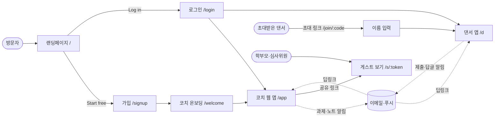
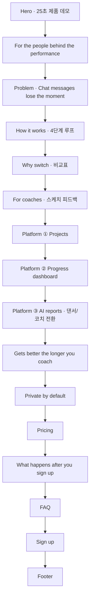
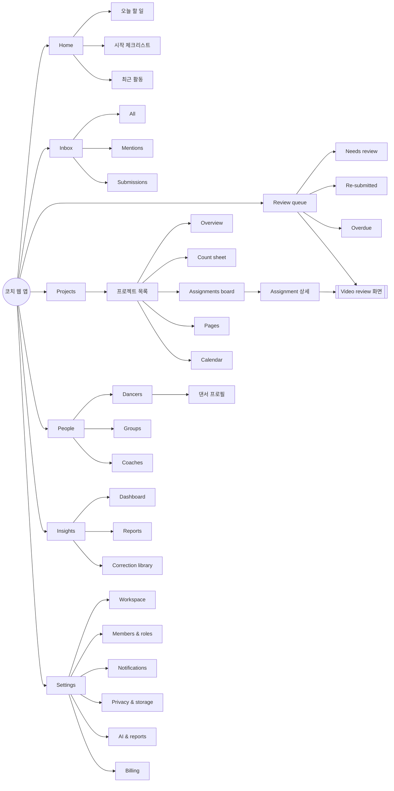
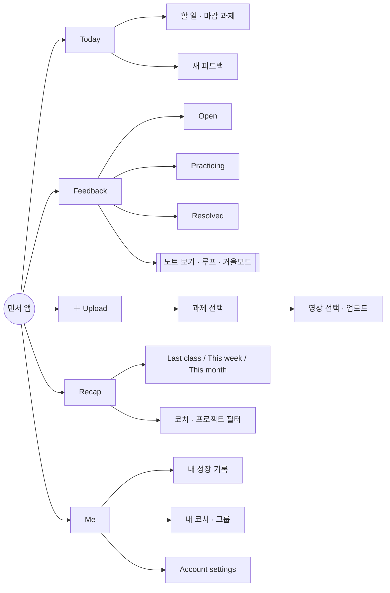

# 01. 메뉴 구조도 (Information Architecture)

> 용어는 [README 용어 사전](README.md#용어-사전)을 따른다.

## 1. 전체 서비스 맵

| 영역 | 사용자 | 기기 | 형태 |
|---|---|---|---|
| 랜딩페이지 | 방문자 | 전체 | 정적 사이트 |
| 코치 웹 앱 | Owner · Coach · Assistant | 노트북 우선, 모바일 대응 | 사이드바 레이아웃 |
| 댄서 앱 | Dancer | **휴대폰 우선** | 하단 탭 레이아웃 (PWA, 앱 설치 불필요) |
| 게스트 보기 | Guest (학부모·심사위원) | 전체 | 읽기 전용 단일 화면 |

> 한 사람이 여러 역할일 수 있다. 예: 코치이면서 다른 코치에게 배우는 댄서.
> 상단 계정 메뉴의 **역할·워크스페이스 전환**으로 이동한다.

---

## 2. 랜딩페이지 구조 (`/`)

### 2-1. 헤더

| 메뉴 | 이동 | 비고 |
|---|---|---|
| 로고 | `#top` | |
| How it works | `#workflow` | |
| Platform | `#projects` | 프로젝트·대시보드·AI 리포트 묶음의 시작 |
| Why Looproom | `#compare` | |
| Pricing | `#pricing` | |
| FAQ | `#faq` | |
| Log in | `/login` | 현재는 `/app` 데모로 연결 |
| **Start free** | `#signup` | 주 CTA |

모바일: 햄버거 메뉴 + **스크롤해도 고정되는 헤더** + 히어로를 지나면 하단 고정 CTA.

### 2-2. 섹션 순서

| # | 섹션 | 앵커 | 목적 | CTA |
|---|---|---|---|---|
| 1 | Hero | `#top` | 3초 안에 가치 전달, 데모로 사용 장면 보여주기 | Review your first video free / Watch the demo |
| 2 | Audience strip | — | 대상 고객 명시 | — |
| 3 | Problem | `#problem` | 공감 | — |
| 4 | How it works | `#workflow` | 핵심 루프 이해 | — |
| 5 | Why switch | `#compare` | 기존 도구와 비교 | — |
| 6 | For coaches | `#features` | 스케치·노트 | Explore the coach workspace |
| 7 | Projects | `#projects` | 시즌 단위 관리 | — |
| 8 | Progress dashboard | `#dashboard` | 데이터 가치 | — |
| 9 | AI reports | `#ai-reports` | 댄서 리캡 / 코치 리포트 | — |
| 10 | Memory | `#memory` | 쓸수록 좋아지는 이유 (락인) | — |
| 11 | Trust | — | 개인정보·보안 | — |
| 12 | Pricing | `#pricing` | Free · Coach · Studio 대기 | Start free |
| 13 | First session | `#first-session` | 가입 후 4단계 안내 (마찰 감소) | — |
| 14 | FAQ | `#faq` | 반론 처리 | — |
| 15 | Sign up | `#signup` | 이메일 가입 | Review your first video free |

### 2-3. 추가로 필요한 페이지

| 페이지 | URL | 상태 |
|---|---|---|
| 개인정보처리방침 | `/privacy` | **필요** (현재 푸터 링크가 `#signup`으로 연결됨) |
| 이용약관 | `/terms` | **필요** |
| 보안·데이터 안내 | `/security` | Phase 2 |
| 도움말 센터 | `/help` | Phase 2 |
| 언어 선택 | `/ko`, `/ja`, `/es` | Phase 3 |

---

## 3. 코치 웹 앱 (`/app`)

### 3-1. 메뉴 트리

### 3-2. 메뉴 상세

| 1단계 | 2단계 | 3단계 / 탭 | 설명 |
|---|---|---|---|
| **Home** | 오늘 할 일 | | 리뷰할 제출, 마감 임박 과제, 멈춰 있는 댄서 |
| | 시작 체크리스트 | | 첫 주에만 표시: 워크스페이스 · 첫 영상 · 첫 노트 · 댄서 초대 |
| | 최근 활동 | | 제출·답글·해결 기록 |
| **Inbox** | All · Mentions · Submissions | | 알림 모음. 읽음/안 읽음 |
| **Review queue** | Needs review · Re-submitted · Overdue | | 모든 프로젝트의 제출을 한 줄로. 여기서 바로 리뷰 화면으로 |
| | → **Video review** | Notes · Versions · Compare | 플레이어 + 노트·스케치 + 버전 비교 |
| **Projects** | 프로젝트 목록 | | 카드 목록, ＋ New from template |
| | 프로젝트 상세 | Overview | 목표, 일정, 참여 댄서, 음악 |
| | | Count sheet | 구간 × 카운트 × 포커스 × 기준 영상 × 상태 |
| | | Assignments board | To submit → In review → Practicing → Fixed |
| | | Pages | 자유 문서 (블록 에디터, @링크) |
| | | Calendar | 리허설·마감 |
| | → Assignment 상세 | Submissions · Brief · Settings | 과제 설명, 제출 현황 |
| **People** | Dancers | | 댄서 목록 → **댄서 프로필**(버전·노트·해결 기록, 리캡 생성) |
| | Groups | | 그룹 목록, 초대 링크 |
| | Coaches | | 공동 코치·어시스턴트 |
| **Insights** | Dashboard | Group · Dancer · Category | 연습 신호 · 피드백 신호 · 동작 신호(Beta) |
| | Reports | Drafts · Sent · Schedule | 코치 리포트 작성·검토·발송, 주간 다이제스트 예약 |
| | Correction library | | 자주 쓰는 노트, 카테고리 관리 |
| **Settings** | Workspace | | 이름, 로고, 언어, 시간대 |
| | Members & roles | | 역할 변경, 초대 관리 |
| | Notifications | | 워크스페이스 기본 알림 |
| | Privacy & storage | | 보관 기간, 공유 링크 허용, 동작 분석(Beta) 허용 |
| | AI & reports | | 댄서 셀프 리캡 허용, 자동 번역, AI 학습 옵트인 |
| | Billing | | 플랜, 결제 수단, 영수증 |

### 3-3. 전역 요소 (모든 화면)

| 요소 | 위치 | 기능 |
|---|---|---|
| 워크스페이스 전환 | 사이드바 상단 | 여러 워크스페이스·역할 이동 |
| **＋ New** | 사이드바 상단 | Assignment · Project · Note · Invite |
| 검색 / **⌘K** | 헤더 | 사람·프로젝트·과제·노트 검색, 명령 실행 |
| 알림 벨 | 헤더 | Inbox 미리보기 |
| 계정 메뉴 | 사이드바 하단 | Account settings, 언어, 도움말, 로그아웃 |

---

## 4. 댄서 앱 (`/d`, 모바일 우선)

### 4-1. 메뉴 트리

### 4-2. 하단 탭

| 탭 | 아이콘 | 내용 | 배지 |
|---|---|---|---|
| **Today** | ⌂ | 오늘 할 일 (마감 과제, 새 노트, 다시 올릴 영상) | — |
| **Feedback** | ◫ | 받은 노트 전체. Open · Practicing · Resolved 탭 | 새 노트 수 |
| **＋** | 가운데 큰 버튼 | 영상 올리기 (과제 선택 → 카메라 롤) | — |
| **Recap** | ✦ | 내 AI 리캡 생성·보기 | — |
| **Me** | ○ | 성장 기록, 내 코치·그룹, 계정 | — |

> 원칙: 알림·초대 링크를 누르면 **해당 노트의 그 순간**으로 바로 열린다 (3탭 이내 규칙).

---

## 5. 게스트 보기 (`/s/:token`)

| 화면 | 내용 | 권한 |
|---|---|---|
| 공유된 영상 | 영상 + 코치가 공개를 허용한 노트 | 보기만, 다운로드 불가 |
| 공유된 리포트 | 월간 성장 리포트 (학부모용) | 보기만, PDF 저장 |

링크는 만료일이 있고 코치가 언제든 해제할 수 있다.

---

## 6. URL 맵

| URL | 화면 | 접근 |
|---|---|---|
| `/` | 랜딩 | 전체 |
| `/signup`, `/login` | 가입·로그인 | 전체 |
| `/welcome` | 코치 온보딩 | 신규 코치 |
| `/join/:inviteCode` | 초대 수락 | 초대받은 사람 |
| `/app` | 코치 Home | Owner·Coach·Assistant |
| `/app/inbox` | Inbox | 〃 |
| `/app/queue` | Review queue | 〃 |
| `/app/review/:submissionId?v=2&t=18.0&note=:id` | Video review | 〃 |
| `/app/projects` | 프로젝트 목록 | 〃 |
| `/app/projects/:id/(overview\|counts\|board\|pages\|calendar)` | 프로젝트 상세 | 〃 |
| `/app/assignments/:id` | 과제 상세 | 〃 |
| `/app/people/(dancers\|groups\|coaches)` | People | 〃 |
| `/app/people/dancers/:id` | 댄서 프로필 | 〃 |
| `/app/insights/(dashboard\|reports\|library)` | Insights | Owner·Coach (Assistant는 보기만) |
| `/app/settings/:section` | 워크스페이스 설정 | Owner (일부 Coach) |
| `/d` | 댄서 Today | Dancer |
| `/d/feedback`, `/d/feedback/:noteId` | 피드백 / 노트 순간 | Dancer |
| `/d/upload?assignment=:id` | 업로드 | Dancer |
| `/d/recap` | 리캡 | Dancer |
| `/d/me` | 내 정보 | Dancer |
| `/account` | 내 계정 설정 (공통) | 로그인 사용자 |
| `/s/:token` | 게스트 보기 | 링크 소지자 |

> 영상 URL에는 항상 `t`(초)와 `note`를 넣을 수 있어 **그 순간을 공유**할 수 있다.

---

## 7. 역할별 메뉴 노출

| 메뉴 | Owner | Coach | Assistant | Dancer | Guest |
|---|---|---|---|---|---|
| Home | ✓ | ✓ | ✓ | Today | — |
| Inbox | ✓ | ✓ | ✓ | (Today에 통합) | — |
| Review queue | ✓ | ✓ | ✓ | — | — |
| Projects | ✓ | ✓ | 보기·노트만 | 참여 프로젝트의 Overview·Count sheet만 | — |
| People | ✓ | ✓ | 보기만 | 내 코치·그룹만 | — |
| Insights › Dashboard | ✓ | ✓ | 보기만 | 내 기록만 (Me) | — |
| Insights › Reports | ✓ | ✓ | 초안만 | 내 Recap만 | 공유된 리포트만 |
| Correction library | ✓ | ✓ | 사용만 | — | — |
| Settings › Workspace·Members·Billing | ✓ | — | — | — | — |
| Settings › Notifications·Privacy·AI | ✓ | 보기만 | — | — | — |
| Account settings | ✓ | ✓ | ✓ | ✓ | — |

---

## 8. 내비게이션 규칙

1. **최대 깊이 3단계**. 4단계가 필요하면 탭으로 푼다. (Projects › Showcase 2026 › Board)
2. **브레드크럼**은 데스크톱 헤더에 항상 표시. 모바일은 ← 뒤로 + 현재 화면 이름.
3. **뒤로 가기**는 이전 화면 상태(필터, 스크롤 위치, 재생 위치)를 보존한다.
4. **딥링크 우선**: 알림·이메일·공유 링크는 목록이 아니라 **해당 노트의 해당 순간**으로 연다.
5. **빈 화면 금지**: 모든 목록의 첫 상태에는 다음 행동 버튼과 샘플이 있다. (05 문서 참고)
6. 리뷰 화면은 **어디서 들어왔는지에 따라 다음 항목**으로 넘어간다. (대기열에서 열면 "다음 제출 →")
