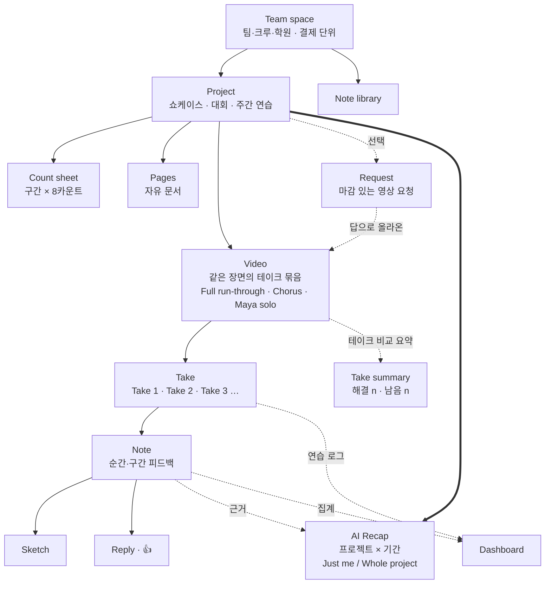
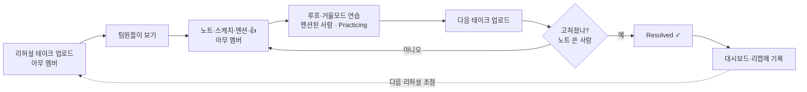
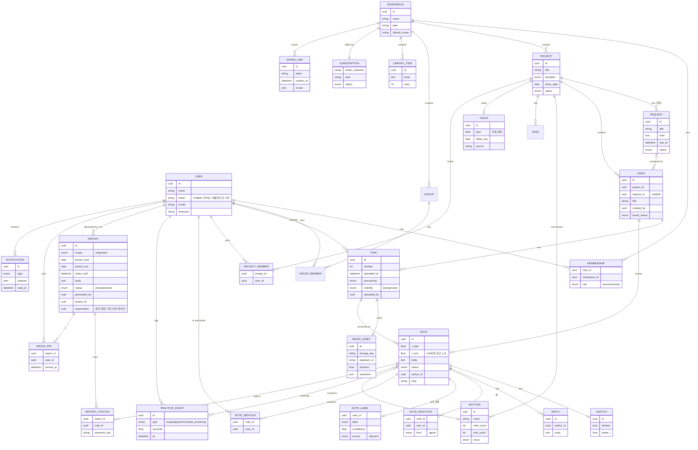
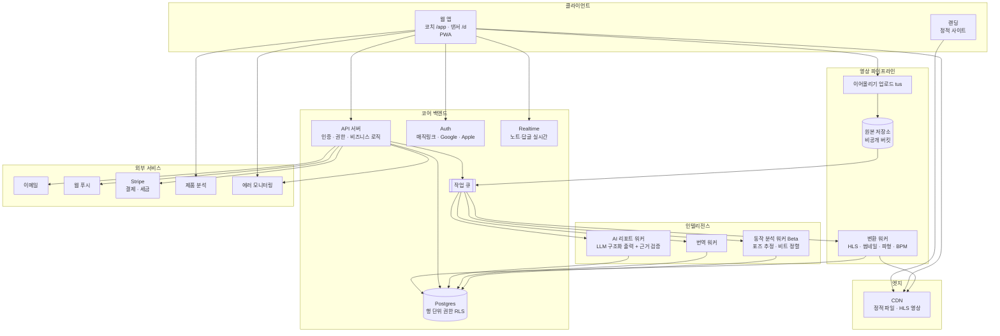
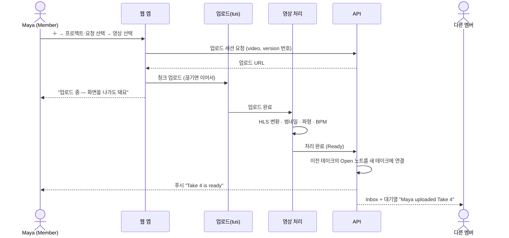
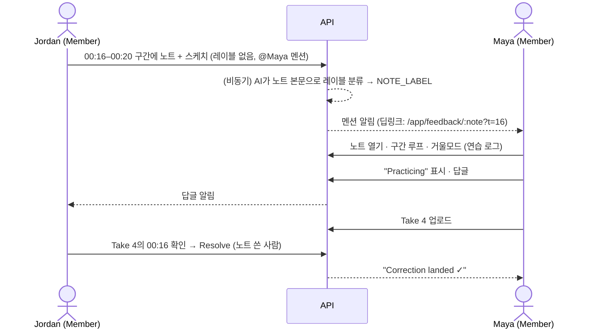
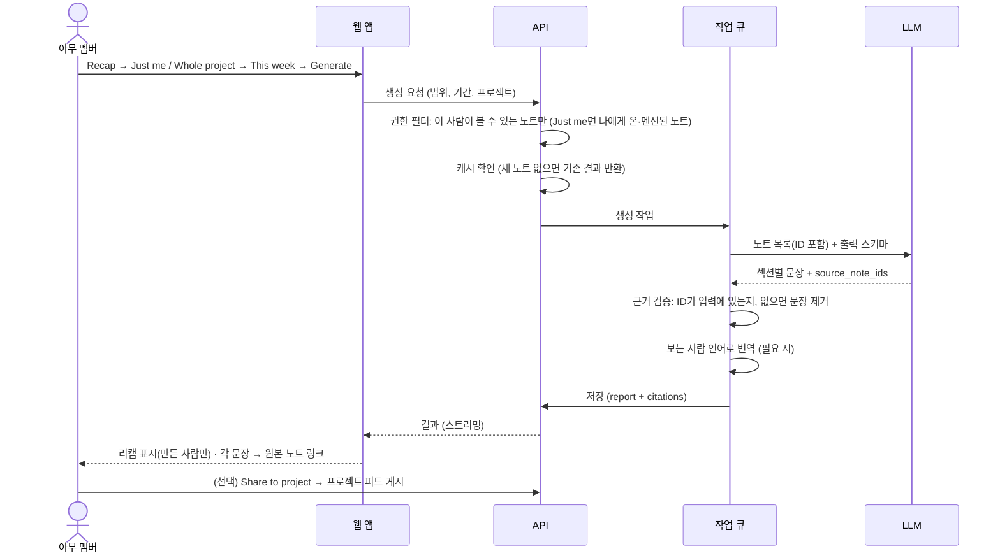
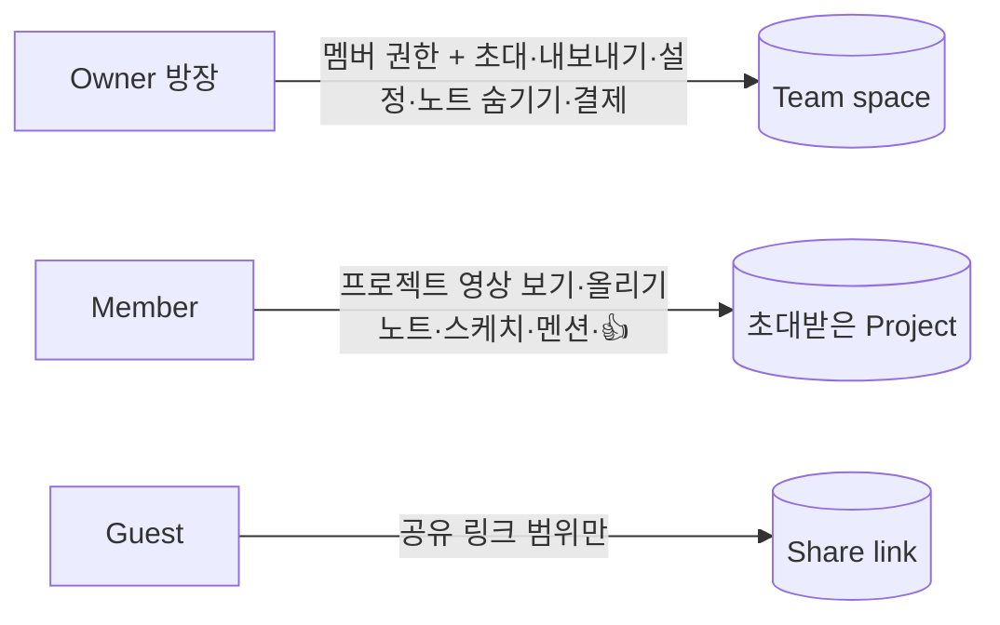

# 02. 서비스 구조도

## 1. 개념 구조: 무엇이 무엇을 담는가

**계층과 원칙**

| 계층 | 화면 이름 | 뜻 | 피드백·요약 |
|---|---|---|---|
| 1 | **Project** | 하나의 목표 (쇼케이스, 대회, 주간 연습) | **AI Recap은 여기서, 기간 기준으로** 만든다 |
| 2 | **Video** | 같은 장면을 반복해 찍은 테이크 묶음. **사용자가 보는 마지막 단계** | 테이크 2개 이상이면 **테이크 비교 요약**(AI 없음): "Take 3 · 4 resolved · 2 still open" |
| 3 | **Take** | 한 번 찍은 영상. 노트가 붙는 곳. **데이터 단계일 뿐, 화면에서는 테이크가 2개 이상일 때 비디오 안의 전환 버튼으로만 보임** | — |
| — | Request (선택) | "금요일까지 Chorus 영상 올려줘" | 없어도 영상은 올릴 수 있다 |

- 노트는 **테이크의 그 순간에 붙지만 Video를 따라간다.** Take 3이 올라오면 Take 2의 해결 안 된 노트가 Take 3 화면에도 "from Take 2"로 보이고, 노트 쓴 사람이 Take 3을 보고 해결한다.
- **리캡이 프로젝트 × 기간인 이유**: 한 번의 리허설에 전체 런스루·구간·개인 영상이 섞여 올라온다. 여러 Video에 흩어진 같은 지적을 모아야 "3명이 3주째 말하는 문제" 같은 합의 신호가 보인다. 리캡을 만들 때 특정 Video로 좁히는 필터는 선택 사항이다.
- 테이크 하나 단위 요약은 만들지 않는다 (노트 몇 개라 직접 읽는 게 빠르다).
- 대시보드와 리캡은 **새 데이터를 만들지 않는다.** 노트·테이크·연습 로그를 모아서 보여줄 뿐이다. (신뢰의 근거)

## 2. 핵심 가치 루프

North Star Metric: **주간 해결된 노트 수 (Notes resolved / week)**

---

## 3. 데이터 모델

**설계 메모**
- `NOTE.t_start / t_end`: 초 단위 저장. 화면에서는 `TRACK.bpm`과 `offset`으로 **카운트 표기로 변환**한다 (저장은 시간, 표시는 카운트).
- `NOTE_LABEL`: 노트 작성 직후 AI가 비동기로 분류한다. 코치가 리포트·대시보드에서 고치면 `source=coach`로 바뀌고 다시 덮어쓰지 않는다. 화면 표시 기준: 신뢰도 0.6 미만이면 "Unlabeled".
- `NOTE_MENTION`: 멘션 가능한 사람은 **그 프로젝트에 초대된 사람**으로 제한한다 (워크스페이스 전체 아님).
- `NOTE.lang`: 작성 언어. 번역문은 캐시 테이블에 따로 둔다 (원문 보존).
- `PRACTICE_EVENT`: 대시보드의 연습 신호 원천. 개인 식별 가능한 데이터이므로 보관 기간 정책 적용.
- 동작 신호(Beta)는 `MOTION_METRIC` 테이블로 분리하고, 워크스페이스 옵트인·보호자 동의가 있을 때만 생성.

---

## 4. 시스템 구성

### 4-1. 권장 기술 구성 (초기)

| 영역 | 권장 | 이유 | 대안 |
|---|---|---|---|
| 웹 앱 | Next.js (React) + PWA | 코치·댄서 한 코드베이스, 앱 설치 없이 홈 화면 추가 | SvelteKit |
| DB·인증·실시간 | Supabase (Postgres + Auth + Realtime + RLS) | 행 단위 권한으로 "댄서는 자기 것만" 을 DB에서 강제 | Firebase, 자체 Postgres |
| 영상 | Mux (업로드·HLS·서명 재생 URL) | 변환·CDN·보안 재생을 직접 만들 필요 없음 | Cloudflare Stream, S3 + ffmpeg |
| 작업 큐 | 큐 서비스 + 서버리스 워커 | AI·번역·분석은 비동기 | Inngest, BullMQ |
| AI | LLM API (구조화 JSON 출력) | 근거 노트 ID를 받아 서버에서 검증 가능 | |
| 결제 | Stripe Billing + Stripe Tax | 글로벌 통화·세금 | Paddle |
| 이메일 | 트랜잭션 메일 서비스 | 다국어 템플릿 | |
| 분석 | 제품 분석 도구 (이벤트 기반) | 퍼널·리텐션 | |

> 현재 저장소는 정적 랜딩 + 프론트엔드 프로토타입이다. Phase 2에서 위 구성으로 옮긴다.

---

## 5. 핵심 시퀀스

### 5-1. 영상 업로드 → 리뷰 가능

### 5-2. 노트 → 연습 → 해결

### 5-3. AI 리캡 생성 (누구나)

---

## 6. 권한 구조 (요약)

자세한 표는 [06-policy.md](06-policy.md#1-권한) 참고.

- DB에서 **행 단위 권한(RLS)** 으로 강제한다. 프론트엔드 숨김만으로 막지 않는다.
- 멤버는 **초대받은 프로젝트의 Team 범위 영상과 노트**를 모두 본다. 다른 프로젝트와 남의 Private take는 볼 수 없다.
- AI 리캡 입력도 같은 권한 필터를 거친 노트만 사용한다.

---

## 7. 데이터 수집 (대시보드 원천)

| 신호 | 이벤트 | 발생 위치 | 대시보드 지표 |
|---|---|---|---|
| 연습 | `video_created`, `take_uploaded` | 업로드 완료 | 제출률, 마감 준수 |
| 연습 | `loop_played` (구간, 횟수, 초) | 댄서 플레이어 | 구간 루프 횟수, 연습 시간 |
| 연습 | `mirror_toggled`, `speed_changed` | 플레이어 | 연습 방식 분포 |
| 연습 | `note_marked_practicing` | 노트 | 연습 중 노트 수 |
| 피드백 | `note_created` → `note_labeled` (AI 레이블) | 코치 리뷰 → 비동기 분류 | 레이블별 노트 수·추이 |
| 피드백 | `note_resolved` (테이크 번호) | 코치 리뷰 | 해결률, **해결까지 걸린 테이크 수** |
| 피드백 | 같은 레이블·구간 노트가 3주 이상 반복 | 배치 집계 | **반복되는 교정** |
| 동작 (Beta) | `motion_analyzed` | 분석 워커 | 박자 대비 오차(ms), 동작 크기, 대칭 |
| 리포트 | `recap_generated`, `report_sent`, `report_opened`, `todo_checked` | 리포트 | 생성 빈도, 열람률, 체크리스트 완료율 |

---

## 8. 비기능 요구사항

| 항목 | 목표 |
|---|---|
| 영상 첫 프레임 | 1.5초 이내 (HLS + CDN) |
| 노트 목록 표시 | 영상보다 먼저, 300ms 이내 (텍스트 우선 로딩) |
| 업로드 | 끊김 후 이어올리기, 최대 2GB, 화면 이탈 가능 |
| 가용성 | 99.9% (월) |
| 보안 | 비공개 버킷, 서명된 재생 URL(만료), 전송·저장 암호화 |
| 개인정보 | GDPR/CCPA 내보내기·삭제, 미성년자 보호자 동의 |
| 접근성 | WCAG 2.1 AA |
| 다국어 | UI 문자열 분리(i18n), 날짜·시간·통화 현지화 |
