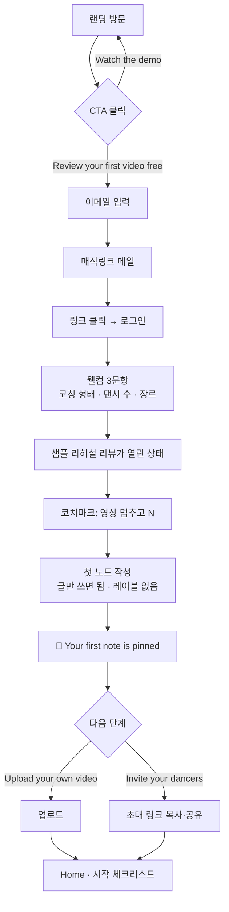
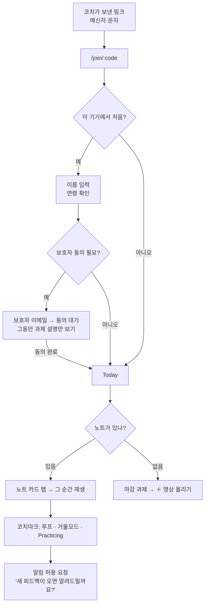
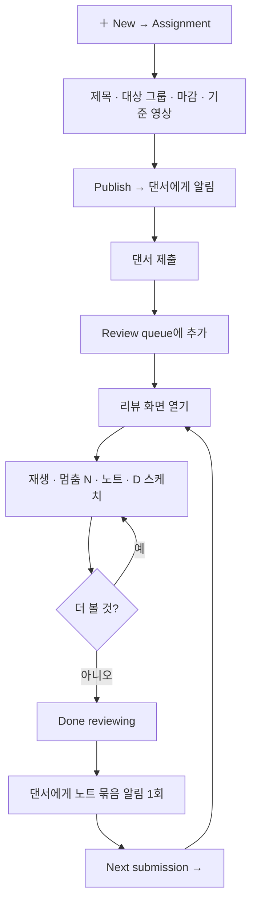
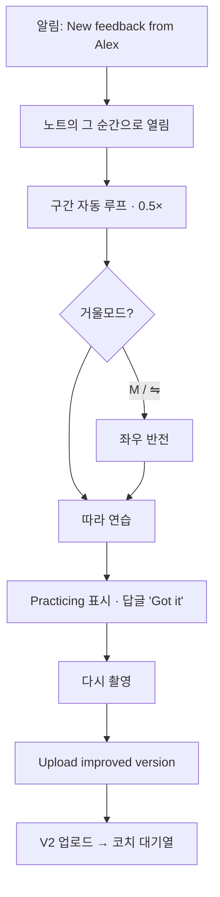
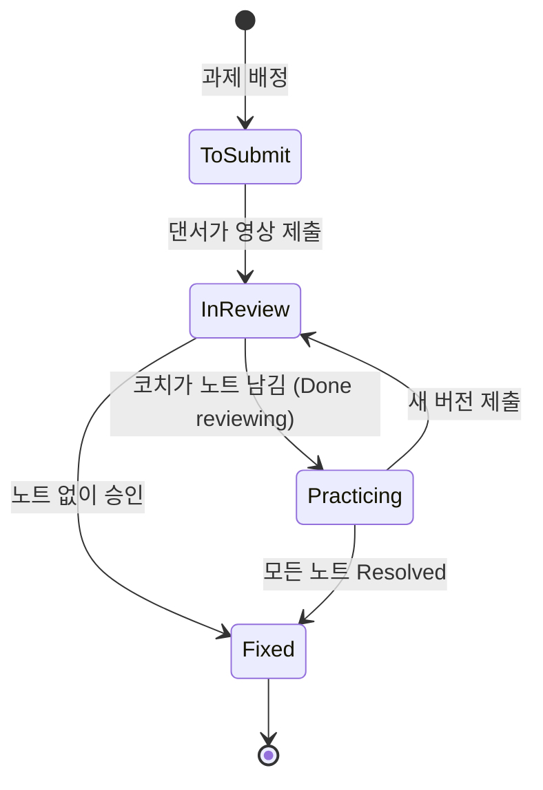
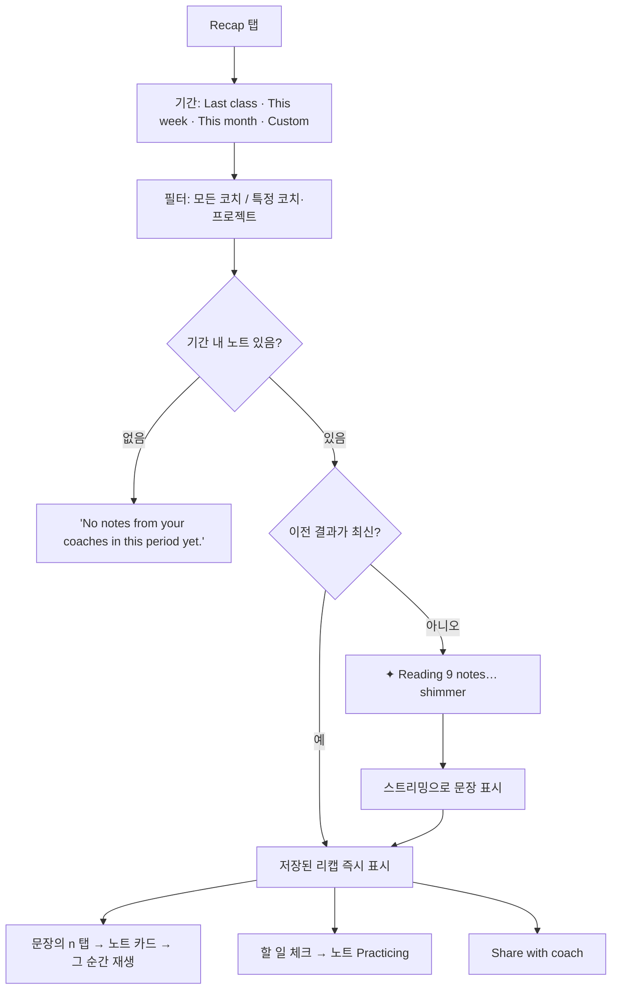
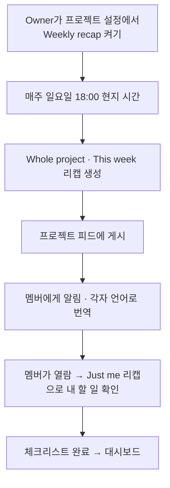
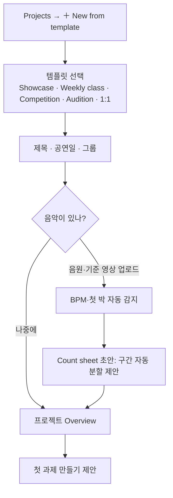
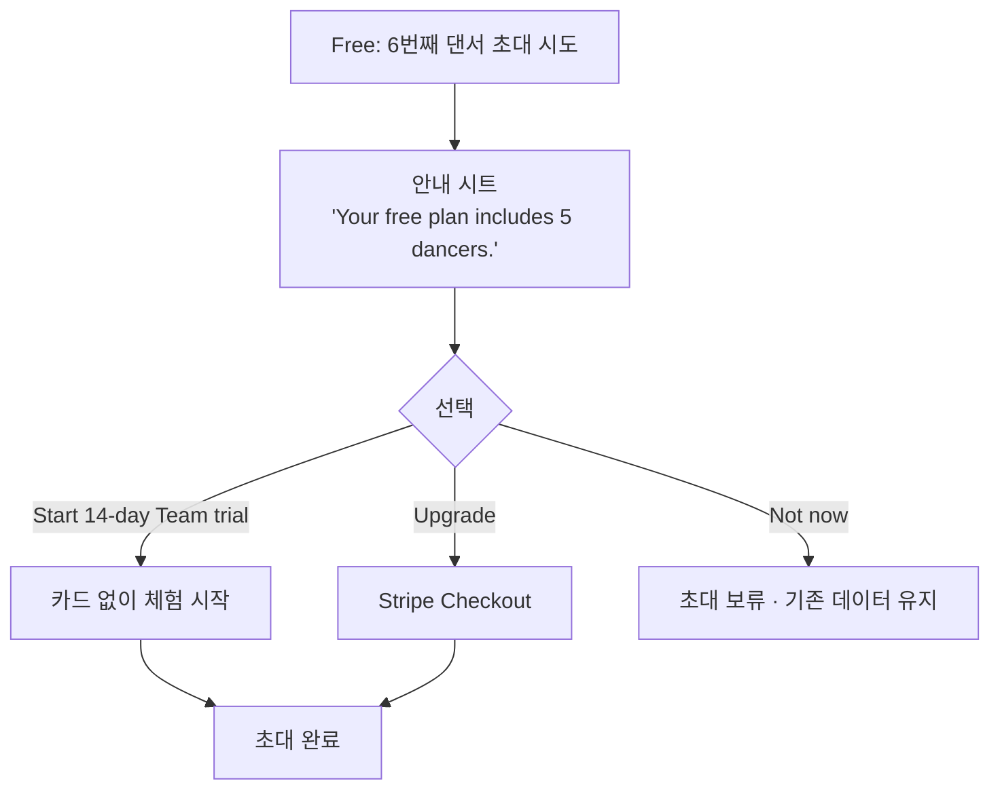
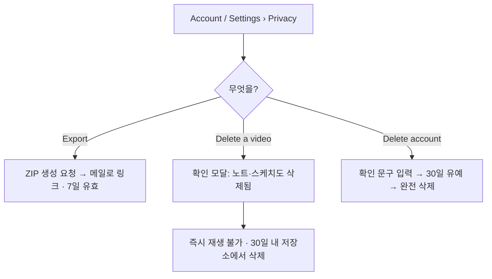

# 04. 사용자 플로우

## 1. 페르소나

| | **Riko Kato** · 팀 리더 → Owner ⭐ 주 고객 | **Maya Chen** · 팀원 → Member | **Alex Lee** · 코치 → Member | **Jin Park** · 학원 원장 → 팀 공간 Owner |
|---|---|---|---|---|
| 상황 | 대학 댄스 동아리 공연팀 리더, 12명, 코치 없음 | 커머셜 팀 소속, 쇼케이스 준비 | 팀 2곳을 봐주는 안무가 | 강사 5명, 수강생 120명 |
| 기기 | 노트북 + 휴대폰 | **휴대폰만** | 노트북으로 리뷰 | 노트북 |
| 지금 쓰는 것 | 단톡방에 런스루 영상, 각자 음성·텍스트로 피드백 | 단톡방, 카메라 롤 | 단톡방 + 드라이브 | 단톡방, 엑셀 |
| 불편 | 피드백이 채팅에 묻힘, 누가 누구에게 한 말인지 모름, 같은 말 반복 | 내 얘기인지 모름, 어디를 고치라는지 모름 | 같은 말 반복, 팀원끼리 한 말을 모름 | 강사별 차이, 학부모에게 성장 보여주기 어려움 |
| Looproom에서 원하는 것 | 런스루 하나에 모두의 피드백을 모으고, 다음 런에서 고쳐졌는지 확인 | 나에게 온 노트만 모아 보고, 내 파트 반복 연습 | 팀원 노트 위에 코치 의견 더하기 | 스튜디오 전체 현황, 학부모 리포트 |
| 결제 | **Team 플랜** | 무료 | 무료 (팀이 Member로 초대) | Studio 플랜 |

## 2. 활성화 기준 (Aha moment)

| 사용자 | 활성화 정의 | 목표 시간 |
|---|---|---|
| 코치 | **첫 노트를 남기고 댄서 1명 이상 초대** | 가입 후 10분 이내 |
| 댄서 | **노트를 눌러 그 순간을 재생** | 초대 링크 클릭 후 30초 이내 |
| 리텐션 신호 | 2주 연속 과제 1개 이상 + 해결 노트 1개 이상 | 가입 후 14일 |

---

## F1. 방문자 → 코치 가입 → 첫 노트

| 단계 | 화면 | 핵심 문구 | 이탈 방지 |
|---|---|---|---|
| C | 가입 폼 | "Review your first video free" | 이메일 1칸, 카드 없음 |
| D | 메일 대기 | "Check your inbox — the link works for 15 minutes." | 메일 재전송, Google로 계속 |
| F | 웰컴 | "Tell us how you coach" | 건너뛰기 가능 |
| G | 샘플 리뷰 | "This is a sample rehearsal. Try pinning a note." | 빈 화면 없음 |
| J | 축하 | "That’s the loop: pin it, they practice it, you check the next take." | 다음 행동 2개만 |

---

## F2. 댄서 초대 수락 → 첫 피드백

**설계 포인트**
- 이메일·비밀번호를 처음에 묻지 않는다. 다른 기기에서 쓰고 싶을 때 "Save your progress"로 이메일을 연결한다.
- 알림 권한은 **가치를 경험한 뒤**(첫 노트 열람 후)에 묻는다.

---

## F3. 과제 → 제출 → 리뷰 (코치 루프)

- 노트를 하나 남길 때마다 알림을 보내지 않는다. **"Done reviewing"을 누르거나 10분간 입력이 없으면** 한 번에 보낸다.
- 대기열에서 열었으면 리뷰를 마친 뒤 바로 다음 제출로 넘어간다.

---

## F4. 댄서 연습 루프

---

## F5. 해결과 보드 상태 (자동)

| 노트 상태 | 누가 바꾸나 | 계기 |
|---|---|---|
| Open | 시스템 | 노트 작성 |
| Practicing | 댄서 | "I’m on it" 버튼, 또는 리캡 체크리스트 체크 |
| Resolved | 코치 | 새 버전에서 확인 후 Resolve (`R`) |

---

## F6. 댄서 리캡 생성

---

## F7. 주간 자동 리캡 (프로젝트)

검토·발송 단계는 없다. 모든 문장에 출처가 있고, 틀린 문장은 누구나 신고 → 다시 생성할 수 있다.

---

## F8. 프로젝트 만들기

---

## F9. 업그레이드 (한도 도달)

원칙: 한도는 **새로 만드는 것만** 막는다. 이미 있는 영상·노트·리포트는 절대 막지 않는다.

---

## F10. 내 데이터 내보내기·삭제

---

## 3. 감정 곡선 (코치 첫 2주)

| 시점 | 행동 | 감정 | 설계 대응 |
|---|---|---|---|
| 가입 직후 | 샘플 리뷰에 노트 | 😮 "이거 빠르네" | 샘플·코치마크 |
| 첫날 | 댄서 초대 | 😟 "애들이 가입할까?" | 이름만으로 참여, 초대 문구 템플릿 |
| 2~3일 | 첫 제출 리뷰 | 🙂 | 대기열 + Next submission |
| 1주 | 첫 해결 | 😊 "진짜 고쳤네" | 해결 축하, 대시보드 첫 데이터 |
| 2주 | 첫 주간 리포트 | 😍 "이걸 내가 안 썼는데" | 출처 인용으로 신뢰 |
